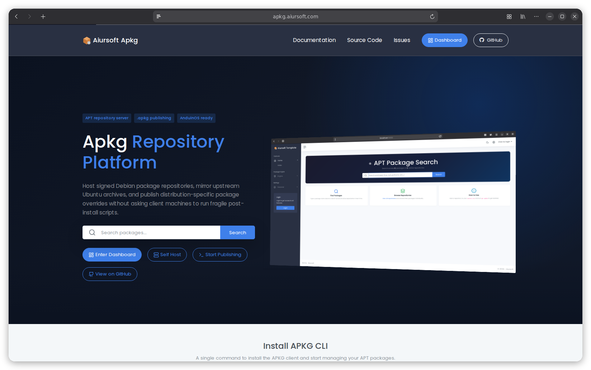

# Apkg

[](https://github.com/aiursoftweb/apkg/blob/master/LICENSE)
[](https://gitlab.aiursoft.com/aiursoft/apkg/-/pipelines)
[](https://gitlab.aiursoft.com/aiursoft/apkg/-/pipelines)
[](https://manhours.aiursoft.com/r/github.com/aiursoftweb/apkg.html)
[](https://apkg.aiursoft.com)
[](https://hub.docker.com/r/aiursoft/apkg)

Apkg is an APT repository server and Debian package publishing platform. It mirrors upstream Ubuntu repositories, signs repository snapshots, accepts `.apkg` package uploads, and serves packages through standard `apt update` and `apt install` workflows.



Default user name is `admin@default.com` and default password is `Admin@123456!`.

## Try

Try a running Apkg instance [here](https://apkg.aiursoft.com).

## What is Apkg?

Apkg is built for Debian-compatible distribution work such as AnduinOS. It lets maintainers keep Ubuntu as an upstream source while publishing distribution-specific package overrides from a managed web portal or CI/CD pipeline.

Apkg provides:

- A signed APT repository server for Debian and Ubuntu clients.
- Upstream APT mirror synchronization.
- Repository snapshot signing and static export.
- `.apkg` bundle publishing for custom `.deb` packages.
- AppStream/DEP-11 generation with GNOME Software icons and server-hosted screenshots.
- A web dashboard for repositories, mirrors, certificates, package uploads, jobs, users, roles, and API keys.
- A `dotnet` global CLI for creating, building, publishing, pushing, and installing packages.

## Package Publishing

Install the CLI:

```bash
dotnet tool install --global Aiursoft.Apkg.Client
```

Create, build, and push a package:

```bash
apkg new --name my-package
apkg add --path ./my-package --file ./bin/my-tool --target /usr/bin/my-tool
apkg lint --path ./my-package
apkg publish --path ./my-package
apkg push ./my-package/bin/my-package.apkg --source https://apkg.example.com --api-key <your-api-key>
```

In CI, resolve versions and skip the complete build when every target already
exists on the destination:

```bash
apkg guess version --path ./my-package
apkg deploy --path ./my-package \
  --source https://apkg.example.com \
  --api-key <your-api-key> \
  --skip-existing
```

Add an Apkg repository to an APT client:

```bash
sudo apkg add-source https://apkg.example.com/api/sources/1
sudo apt update
sudo apt install my-package
```

## Fetch build inputs

Download explicitly named packages without installing them or changing host APT
configuration. Repository, suites, components, architecture, keyring and output
must be supplied; no host settings or extra pockets are inferred:

```bash
apkg fetch grub-common grub2-common grub-efi-arm64-bin \
  --repository https://ports.ubuntu.com/ubuntu-ports \
  --suite resolute --suite resolute-updates --suite resolute-security \
  --component main --arch arm64 \
  --signed-by ./keys/ubuntu-archive-keyring.gpg \
  --output ./grub-inputs --extract
```

`--package NAME` is the explicit alternative to the leading positional package
names. Use `--sources ./ubuntu.sources` for multiple repository/pocket pairs;
this replaces `--repository`, `--suite`, `--component` and `--signed-by`.
The sources file must explicitly specify `Signed-By` in each enabled stanza.
Keyrings must already exist and be trusted by the caller.

`fetch` compares Debian versions across every declared source, verifies repository
signatures and index/package hashes, and writes `manifest.json` plus
`debs/<input-id>/<package>_<version>_<arch>.deb`. `--extract` also produces
`extracted/<input-id>/`. No dependencies are automatically downloaded, no
maintainer scripts are run, and nothing is installed. Extraction requires
`dpkg-deb`; signature verification requires `gpgv` (and `gpg` for armored keys).

Projects can declare `BuildSource` and `BuildInput` items. Fetch them separately
for inspection, or let the existing build pipeline prepare them automatically:

```bash
apkg fetch --path ./my-package --distro ubuntu --suite resolute --arch arm64 \
  --output ./grub-inputs --extract
apkg build --path ./my-package --distro ubuntu --suite resolute --arch arm64
```

Build prepares inputs under `obj/inputs/<distro>/<suite>/<arch>/` and passes
`APKG_INPUTS_DIR` to prebuild commands. See [the build input reference](docs/aosproj.md#构建原料-buildsource--buildinput)
for declarations, host/target architectures, source files and failure behavior.

## Package tests

Declare test entry points separately from build hooks:

```xml
<ItemGroup>
  <TestCommand Name="source" Profile="release"
               Run="bash tests/run.sh" TimeoutSeconds="600" />
  <TestCommand Name="desktop" Profile="gui"
               Run="bash tests/gui.sh" TimeoutSeconds="120" />
</ItemGroup>
```

```bash
apkg test --path ./my-package --profile release
apkg test --path . --recursive --profile release --list
apkg test --path . --recursive --profile release --report test-results.xml
```

The profile is mandatory and matched exactly. Entries run in declaration order,
in their package directory, through `/bin/sh`, with `APKG_TEST_PROFILE` set.
`Name` is unique within a profile. Names and profiles use letters, digits,
periods, underscores and hyphens; they must begin with a letter or digit.
`TimeoutSeconds` defaults to 600 and accepts 1–86400. Build `Condition`
attributes do not apply to tests: use a separate profile for a different
environment.

## Install with Docker

Run the installer with the desired port (omit it to choose an available port):

```bash
curl -fsSL https://raw.githubusercontent.com/aiursoftweb/apkg/master/install.sh | sudo bash -s -- 8080
```

Installation starts after three seconds; press Ctrl+C to cancel. Then open `http://localhost:8080`.

## Run manually

Requirements about how to run

1. Install [.NET 10 SDK](http://dot.net/) and [Node.js](https://nodejs.org/).
2. Execute `npm install` at `src/Aiursoft.Apkg/wwwroot` folder to install the dependencies.
3. Execute `dotnet run --project src/Aiursoft.Apkg/Aiursoft.Apkg.csproj` to run the app.
4. Use your browser to view [http://localhost:5000](http://localhost:5000).

## Run in Microsoft Visual Studio

1. Open the `.sln` file in the project path.
2. Press `F5` to run the app.

## Run in Docker

First, install Docker [here](https://docs.docker.com/get-docker/).

Then run the following commands in a Linux shell:

```bash
image=aiursoft/apkg
appName=apkg
sudo docker pull $image
sudo docker run -d --name $appName --restart unless-stopped -p 5000:5000 -v /var/www/$appName:/data $image
```

That will start a web server at `http://localhost:5000` and you can test the app.

The docker image has the following context:

| Properties  | Value          |
|-------------|----------------|
| Image       | aiursoft/apkg  |
| Ports       | 5000           |
| Binary path | /app           |
| Data path   | /data          |
| Config path | /data/appsettings.json |

## Documentation

- [Design document](docs/design.md)
- [`.aosproj` format](docs/aosproj.md)
- [Development notes](docs/development.md)
- [Operations guide](docs/operations.md)
- [Build preflight and CI deployment](docs/preflight.md)

## How to contribute

There are many ways to contribute to the project: logging bugs, submitting pull requests, reporting issues, and creating suggestions.

Even if you have push rights on the repository, you should create a personal fork and create feature branches there when you need them. This keeps the main repository clean and your workflow cruft out of sight.

We're also interested in your feedback on the future of this project. You can submit a suggestion or feature request through the issue tracker. To make this process more effective, we're asking that these include more information to help define them more clearly.

## License

Apkg is licensed under the [MIT License](LICENSE).
